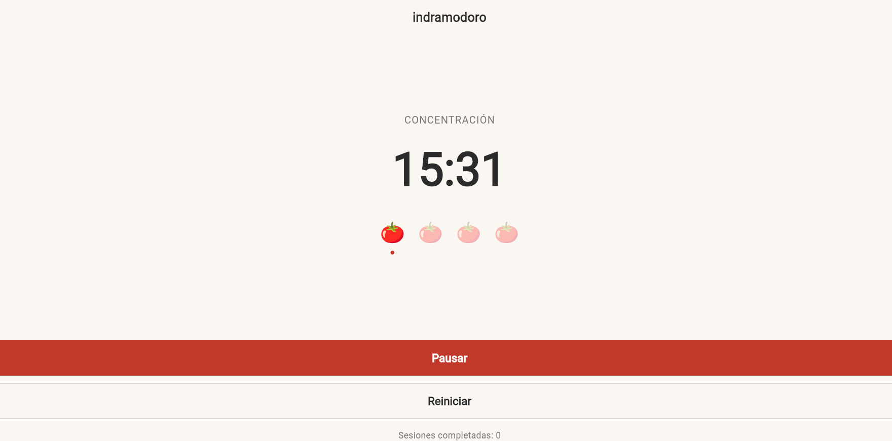

# indramodoro (Flutter)

A minimalist Pomodoro timer: 25 min focus, 5 min short break, 15 min long break after 4 sessions.



## How to run (first time, web)

### 1. Install Flutter

Skip this step if `flutter --version` already works. On Ubuntu / WSL:

```bash
sudo apt update
sudo apt install -y git curl unzip xz-utils zip libglu1-mesa
git clone https://github.com/flutter/flutter.git -b stable ~/flutter
echo 'export PATH="$HOME/flutter/bin:$PATH"' >> ~/.bashrc
source ~/.bashrc
flutter config --enable-web
```

`flutter doctor` may report a missing Android toolchain, Chrome, or Linux toolchain. Ignore these; they are not needed for web.

### 2. Set up the project

From the project folder (the one with `pubspec.yaml`):

```bash
flutter create . --project-name indramodoro_flutter --platforms=web
flutter pub get
```

`flutter create .` only adds the `web/` folder. It does not overwrite `lib/` or `pubspec.yaml`.

### 3. Run

```bash
flutter run -d web-server --web-port 8080
```

The first build takes a couple of minutes. When it finishes, open `http://localhost:8080` in your browser.


## Structure

- `lib/pomodoro_timer.dart`: timer logic
- `lib/main.dart`: UI
